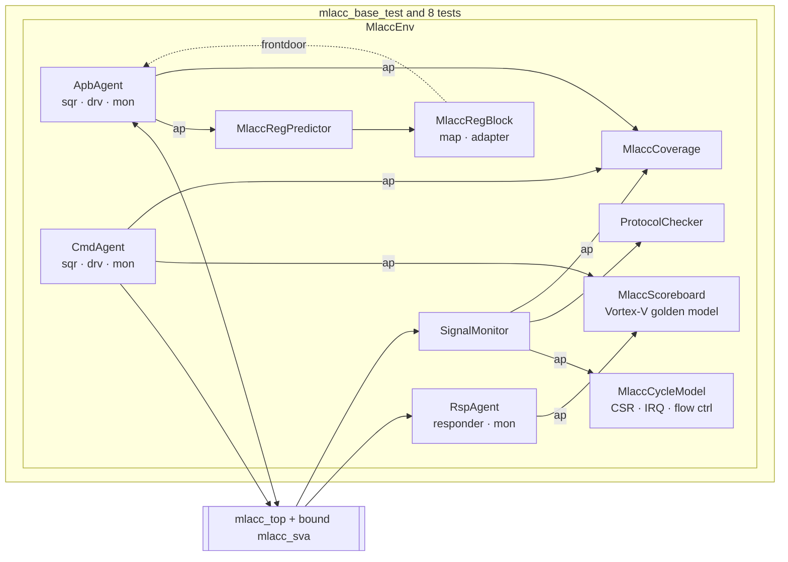

# MLACC-UVM

A coverage-driven **UVM verification environment** for **MLACC**, a small ML accelerator IP:
the int8 dot-product / multiply-accumulate / requantize datapath of the
Vortex-V RISC-V core (`vortex_xmlacc.sv`, used byte-for-byte) wrapped with an
**APB3 register block**, **valid/ready command and result streams**, a 4-deep result FIFO with
credit-based flow control, and an interrupt.

There are two benches with the same architecture:
- **SystemVerilog UVM** (`sv_uvm/`): Accellera UVM 1800.2-2017 on **Verilator 5.054**, with the
  standard `uvm_reg_predictor` and the library's built-in `uvm_reg_hw_reset_seq` / `uvm_reg_bit_bash_seq`.
- **pyuvm** (`tb/`): IEEE 1800.2 UVM in Python on **cocotb + Icarus Verilog**. This is the deeper
  bench (cycle model, protocol checkers, full coverage model, mutation campaign).

Protocol rules also exist as **SystemVerilog assertions** run under Verilator.

## Results

| | |
|---|---|
| Regression | 9 tests, 30 seeded runs, all passing (~15 s on 4 cores) |
| Functional coverage | **150/150 bins (100%)**, 21 coverpoints and crosses — [docs/COVERAGE.md](docs/COVERAGE.md) |
| Bug injection | **15/15 injected RTL bugs caught** — [docs/MUTATION.md](docs/MUTATION.md) |
| SVA | 6 assertions, 4 environment assumptions and 3 covers, bound into the DUT, run with Verilator `--assert` |
| Real bug found | **VTX-RQS-001** in Vortex-V's `rqs`, found by random stimulus on the very first run, now fixed upstream (Vortex-V PR #2) — [docs/KNOWN-ISSUES.md](docs/KNOWN-ISSUES.md) |

## Testbench architecture



- **Agents:** APB3 master (active), command stream master with random idle gaps (active),
  result stream slave with random stall bursts (reactive), plus a passive per-cycle signal monitor.
- **RAL:** `uvm_reg_block` with 9 registers / 15 fields (RO, RW, W1C, volatile), an APB adapter
  and an **explicit predictor** (pyuvm ships no predictor body, so it is implemented here).
- **Scoreboard:** in-order, tag-checked comparison against Vortex-V's independent numpy golden model.
- **Cycle model:** a cycle-accurate model of the register block, interrupt and flow control that
  checks every APB read, `PSLVERR`, `irq` and `cmd_ready` every cycle.
- **Coverage:** a small covergroup library (coverpoints, crosses, illegal bins) and a merge script.
- **Sequences:** constrained-random traffic with weighted `dist`-style constraints over operand
  classes, rqs shift ranges, rounding points and accumulator wrap; directed corner sequences;
  RAL reset / bit-bash / access sequences; a virtual sequence that runs CSR traffic concurrently with
  data traffic.

## SystemVerilog UVM bench (`sv_uvm/`)

`mlacc_uvm_pkg.sv` holds APB / command / result agents, a `uvm_reg_block` with an APB
`uvm_reg_adapter` and `uvm_reg_predictor`, an in-order scoreboard with a SystemVerilog port of the
Vortex-V golden model, a `covergroup` with an op × operand cross, `rand` sequence items with
`dist` constraints (solved by Verilator's z3 back end), and four tests:

| Test | Purpose |
|---|---|
| `smoke_test` | 50 random commands, no stalls |
| `random_test` | 2000 constrained-random commands with backpressure; checks CMD/RSP_COUNT against the scoreboard |
| `stress_test` | 3000 back-to-back commands into 50% backpressure |
| `reg_builtin_test` | UVM built-in hardware-reset and bit-bash register sequences |

It catches the injected bugs too, for example `MUTANT_SCRATCH_BIT` (bit-bash flags bit 15) and
`MUTANT_DOT8SU_AS_U` (238 scoreboard mismatches in `random_test`).

```bash
sudo apt-get install -y z3            # Verilator's constraint solver
# Verilator 5.054 built from source; UVM from github.com/antmicro/uvm-verilator (pinned in CI)
VERILATOR=/path/to/verilator UVM_HOME=/path/to/uvm-verilator/src sim/run_sv_uvm.sh random_test 7
```

## pyuvm tests

| Test | Purpose |
|---|---|
| `smoke_test` | one of each op + 50 random |
| `reg_test` | reset values, walking-1/0 bit-bash, RO write-ignore, unmapped `PSLVERR`, W1C |
| `corner_test` | lane extremes, macc wrap, every rqs shift boundary and half-way point, illegal ops |
| `random_test` | 2000 balanced random commands, light backpressure |
| `stress_test` | 3000 back-to-back commands into 50% bursty backpressure |
| `irq_test` | each IRQ source with its enable on/off, W1C de-assertion |
| `csr_traffic_test` | register polling, W1C clears and enable toggling concurrent with traffic |
| `reset_midflight_test` | reset with a full FIFO, clean restart |
| `rqs_overflow_test` | regression for VTX-RQS-001: rqs inputs next to INT64_MAX |

## Running

```bash
sudo apt-get install -y iverilog verilator
pip install -r requirements.txt

make -C sim TEST=test_mlacc UVM_TEST=random_test SEED=7     # one test
python3 sim/run_regression.py -j 4                           # full regression
python3 sim/coverage_report.py reports/raw/regression/cov    # merged coverage
python3 sim/mutants.py -j 4                                  # bug-injection campaign
sim/run_sva.sh 1                                             # SVA under Verilator
python3 -m pytest tb/unit                                    # reference-model unit tests
```

## Layout

```
sv_uvm/ SystemVerilog UVM bench (interfaces, mlacc_uvm_pkg, tb_top)
rtl/   mlacc_top, mlacc_csr, mlacc_fifo, mlacc_pkg, vortex_xmlacc (+ vortex_pkg), mlacc_sva (bound SVA)
tb/    mlacc_tb/ (agents, RAL, scoreboard, cycle model, coverage, sequences), tests/, unit/
sva/   Verilator harness that executes the bound SVA
sim/   cocotb Makefile, regression runner, coverage merge, mutation campaign
docs/  DUT-SPEC, VPLAN (requirement → test → checker → coverage), COVERAGE, MUTATION, KNOWN-ISSUES
```

## Why both

SystemVerilog UVM is the industry standard, but on free tools it needs a recent Verilator built
from source and a patched UVM tree. The pyuvm bench runs anywhere with `apt` and `pip`, and keeps
the same class hierarchy, phasing, TLM, sequencer/driver handshake, ConfigDB, factory and register
layer, so the two map one-to-one.
